# Versão 2 · capturas de revisão (cenas I e II)

Tiradas no site publicado (`/site_formosinho/v2/`), com o modo de pré-visualização
`?cena=…&p=…`, que fixa um momento exato de cada cena. Computador: 1600 × 900.
Telemóvel: 390 × 844.

## I · Abertura: do habitat à vitrine

| Momento | Captura |
| --- | --- |
| Início: o vídeo do habitat em ecrã inteiro, com o título | 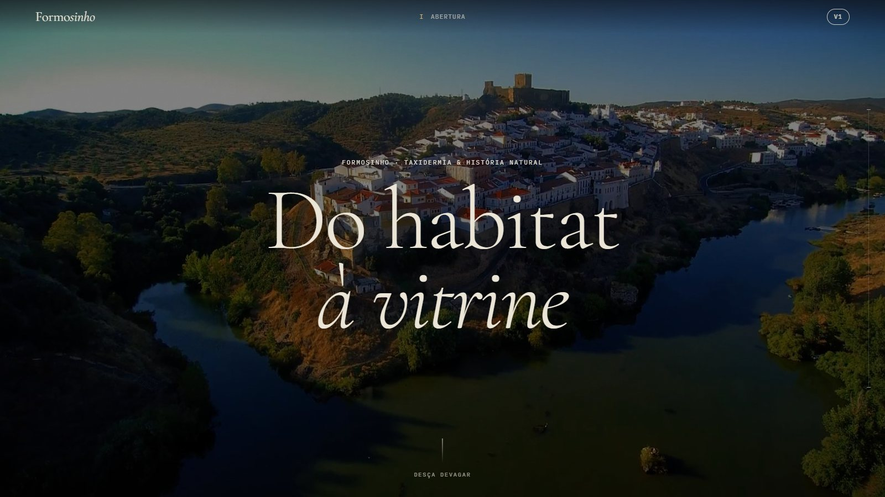 |
| A câmara recua e o habitat fica emoldurado | 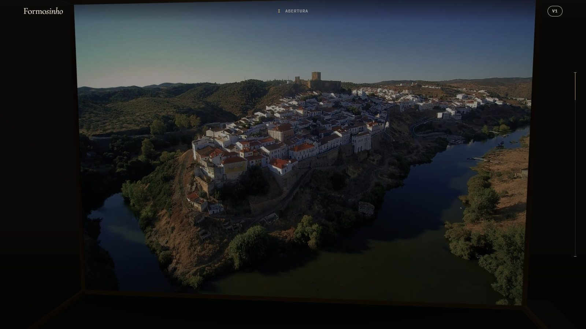 |
| A vitrine surge do escuro, o habitat passa a sépia e a peça aparece em silhueta | 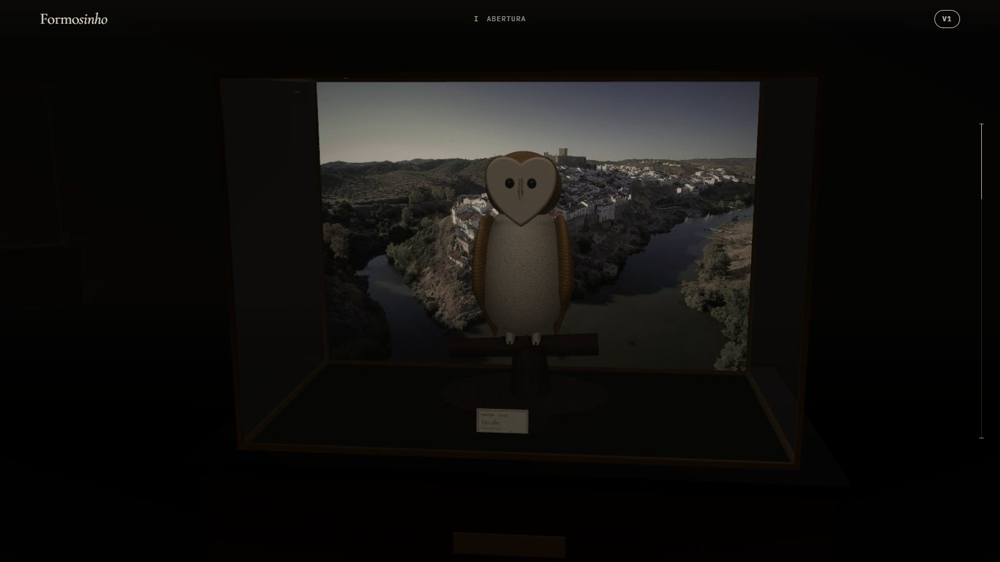 |
| A luz do museu acende e aparece o primeiro cartão | 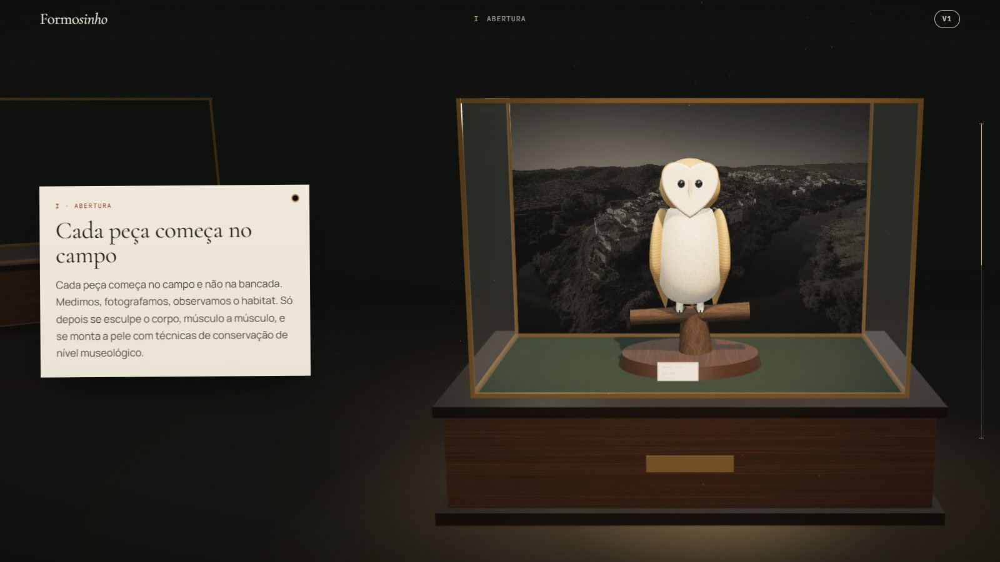 |

## II · Em volta: a câmara orbita a peça

| Momento | Captura |
| --- | --- |
| A cúpula de vidro levanta-se | 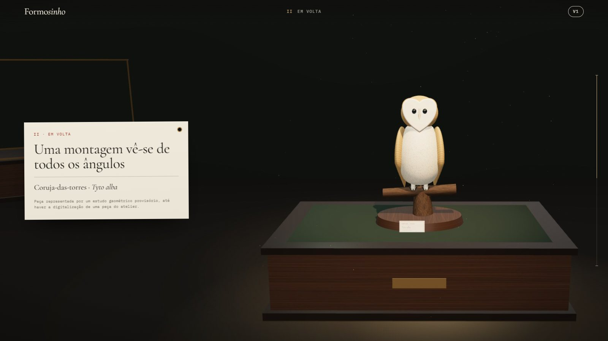 |
| Nota 1/4: disco facial (fio até ao ponto da peça) | 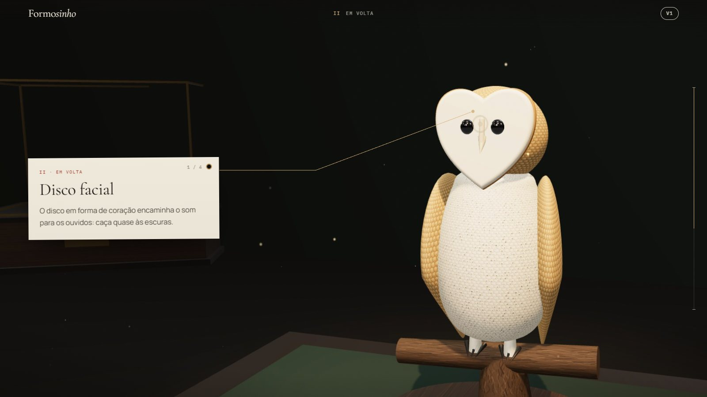 |
| Nota 2/4: voo silencioso | 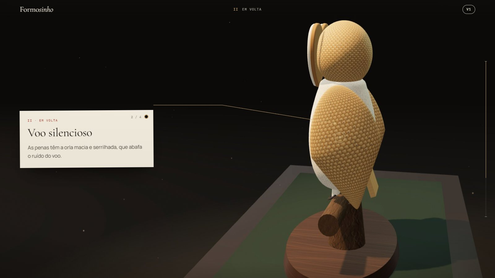 |
| Nota 3/4: garras | 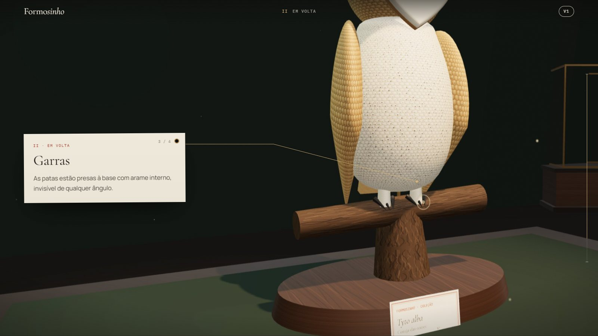 |
| Nota 4/4: etiqueta de coleção | 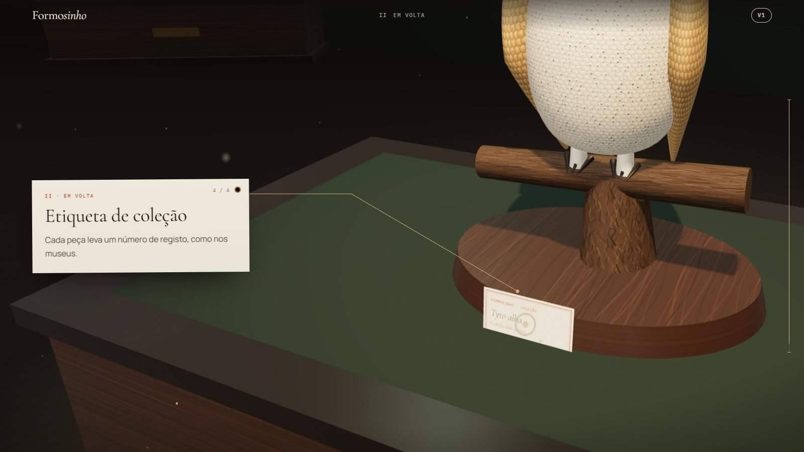 |

## Telemóvel: o 3D fica em cima e o cartão é uma folha no fundo

| Abertura | Luz acesa | Disco facial | Garras |
| --- | --- | --- | --- |
| 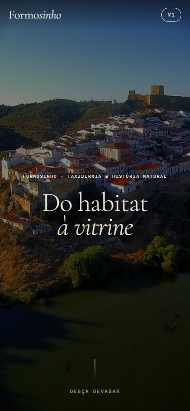 | 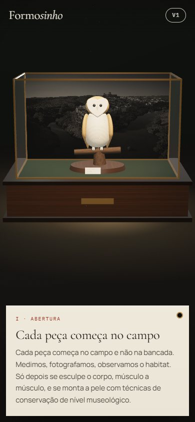 | 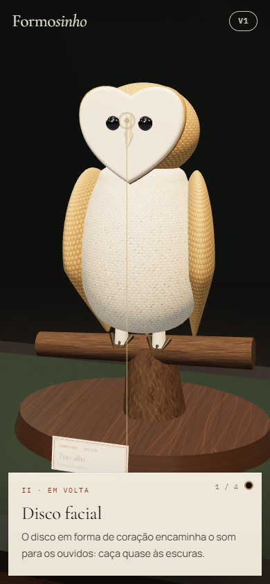 | 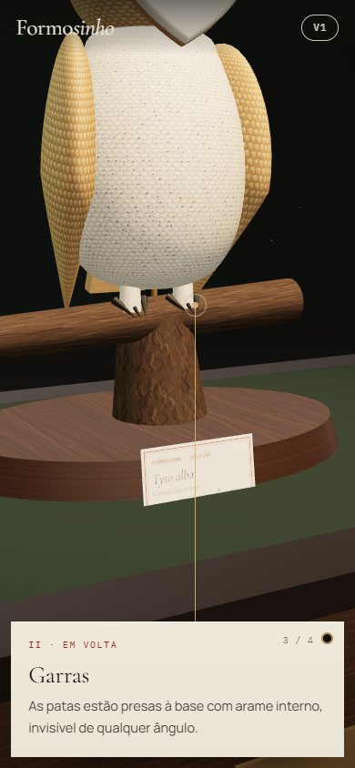 |

> A coruja é um estudo geométrico provisório. Um modelo `.glb` de uma peça do atelier
> substitui-a sem mudar o resto (ver `../MODELOS.md`).
